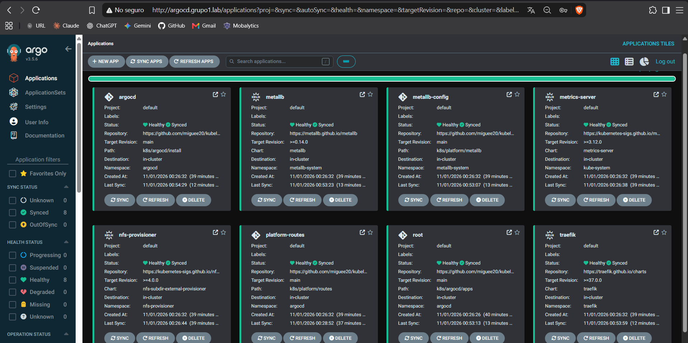
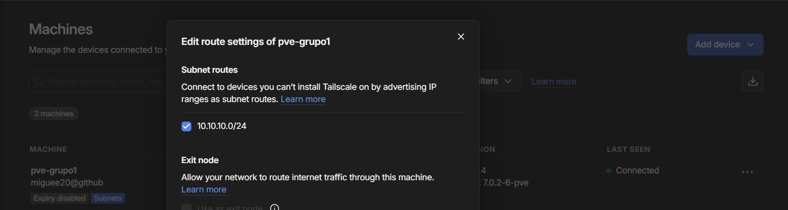

# 03 · Argo CD and platform services

## GitOps model

```
k8s/argocd/root.yaml              (applied once at bootstrap)
   └── k8s/argocd/apps/           (one Application per component)
         ├── argocd               → k8s/argocd/install (Argo CD manages itself)
         ├── metallb              → Helm chart metallb
         ├── metallb-config       → k8s/platform/metallb (IPAddressPool + L2Advertisement)
         ├── traefik              → Helm chart traefik (LoadBalancer 10.10.10.200)
         ├── platform-routes      → k8s/platform/routes (IngressRoutes for platform tools)
         ├── nfs-provisioner      → Helm chart nfs-subdir-external-provisioner (default StorageClass)
         └── metrics-server       → Helm chart metrics-server
```

Every Application has `automated` sync with `prune: true` and `selfHeal: true` (CD-04). Any manual change in the cluster is reverted to what is in Git. Applications that depend on CRDs from another chart use `SkipDryRunOnMissingResource` and a retry policy, so they converge on their own once the CRDs exist.

## Bootstrap (the only manual `kubectl apply`)

In the `pve` shell:

```bash
curl -fsSL https://raw.githubusercontent.com/miguee20/kubelab-grupo1/main/scripts/proxmox/05-bootstrap-argocd.sh -o 05.sh && bash 05.sh
```

[`05-bootstrap-argocd.sh`](../scripts/proxmox/05-bootstrap-argocd.sh) installs Argo CD from [`k8s/argocd/install`](../k8s/argocd/install/kustomization.yaml) and creates the root Application. After that, nothing is applied by hand.

## Argo CD trimmed for 6 GB

| Change | Saving |
|---|---|
| Dex (SSO), notifications and ApplicationSet controllers removed | ~200 MB |
| Memory requests/limits on controller, repo-server, server and redis | Predictable usage |
| `server.insecure: true` | TLS is not needed inside the lab; Traefik serves HTTP |

## Network services

| Component | Configuration |
|---|---|
| MetalLB | Layer 2 mode, pool `10.10.10.200-10.10.10.210` on the internal bridge `vmbr1` (NET-01, INF-06) |
| Traefik | 2 replicas, PodDisruptionBudget, `LoadBalancer` Service pinned to `10.10.10.200` (NET-02). Entry points: `web` (80) and `postgres` (5432) |
| IngressRoute | `argocd.grupo1.lab` → `argocd-server:80` (CD-02) |

## Storage

`nfs-subdir-external-provisioner` creates one folder per PVC in `/srv/nfs/k8s` on the Proxmox host (exported only to `10.10.10.0/24`). The `nfs` StorageClass is the cluster default (PER-01). Since the data lives outside the worker VMs, a pod can be deleted or rescheduled to any worker and still find its volume (PER-02).

The export uses `async`. With `sync`, every `fsync` from SQLite (Grafana), PostgreSQL, Prometheus and Loki waited for the single HDD. Grafana's first start (about 200 migrations) then took longer than its liveness probe and the worker stalled on I/O. The trade-off is that a power loss on the host could drop the last few seconds of writes, which is acceptable for a lab.

## Verification

```bash
kubectl -n argocd get applications          # all Synced / Healthy
kubectl -n traefik get svc traefik          # EXTERNAL-IP 10.10.10.200
kubectl get storageclass                    # nfs (default)
kubectl top nodes                           # metrics-server working
```




