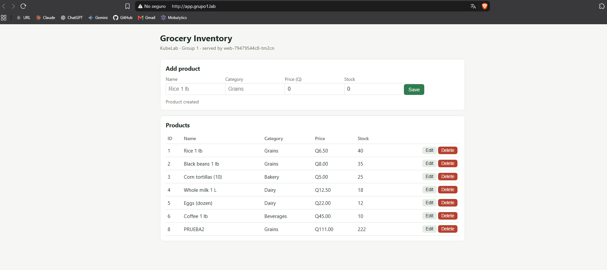
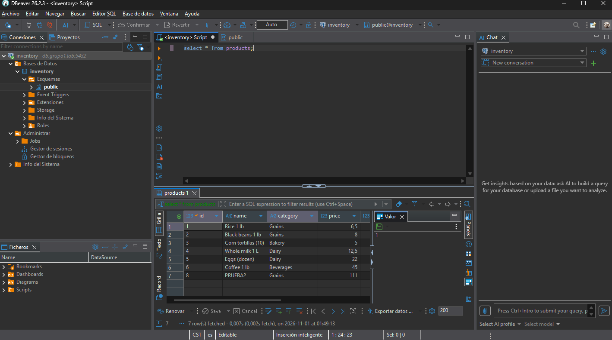
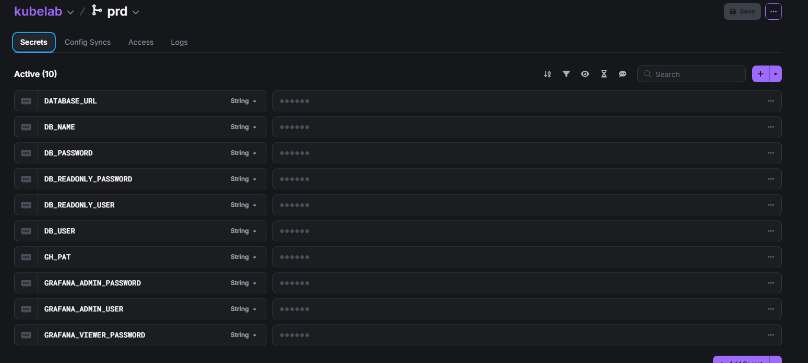
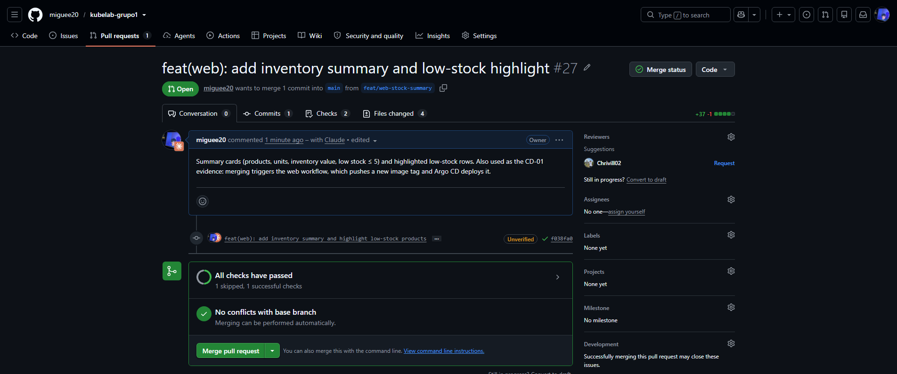
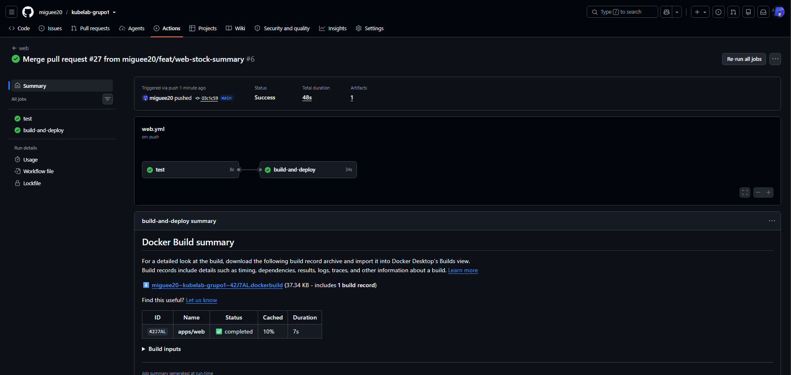
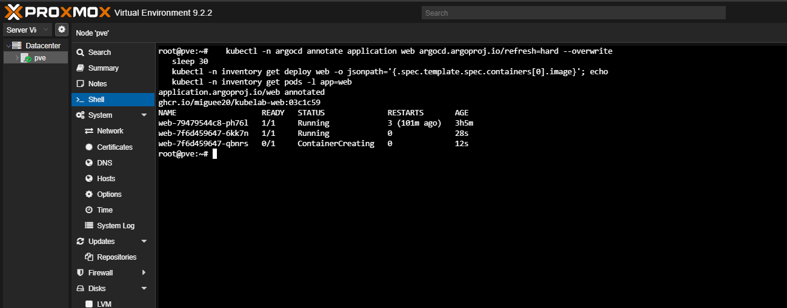
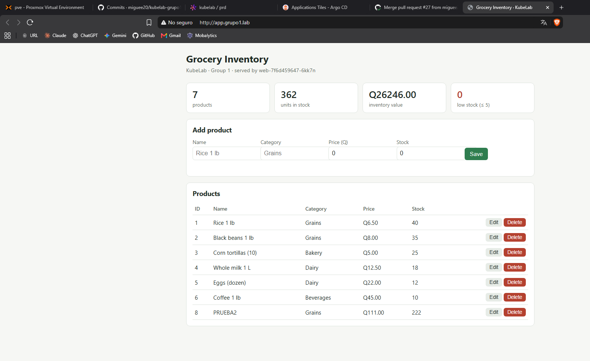

# 04 · Applications, secrets and CI/CD

## Components

| Component | Source | Kubernetes | URL |
|---|---|---|---|
| API (Node.js 22, Express, pg, prom-client) | [`apps/api`](../apps/api) | Deployment + Service + IngressRoute + HPA + PDB | http://api.grupo1.lab |
| Web (static HTML/JS on nginx) | [`apps/web`](../apps/web) | Deployment + Service + IngressRoute + HPA + PDB | http://app.grupo1.lab |
| PostgreSQL 17 | — | StatefulSet + NFS PVC + schema Job + IngressRouteTCP | db.grupo1.lab:5432 |





All of them live in the `inventory` namespace. Each one is its own Argo CD Application: `api`, `web` and `database`.

### API endpoints (APP-01)

| Method | Path | Description |
|---|---|---|
| GET | `/health` | Liveness: `{"status":"ok"}` |
| GET | `/ready` | Readiness: checks the database connection |
| GET | `/metrics` | Prometheus metrics (`http_requests_total`, `http_request_duration_seconds`, Node.js process metrics) |
| GET | `/products` | List products |
| GET | `/products/:id` | Get one product |
| POST | `/products` | Create (`name`, `category`, `price`, `stock`) |
| PUT | `/products/:id` | Update |
| DELETE | `/products/:id` | Delete |

The web app calls the API through `/api/*` on its own origin. nginx proxies those requests to the `api` Service, so the browser never needs CORS.

### Database schema (APP-07)

[`k8s/apps/database/schema.yaml`](../k8s/apps/database/schema.yaml) holds the SQL in a ConfigMap and a Job that runs it as an Argo CD **PostSync hook**. The script is idempotent:
- `CREATE TABLE IF NOT EXISTS`.
- Seed data inserted only when the table is empty.
- Creates or updates the read-only role for the instructor.

## Secrets with Doppler (SEC-01 … SEC-04)

```
Doppler project "kubelab" / config "prd"
   ├── Doppler Kubernetes Operator ── DopplerSecret ──► Secret inventory/inventory-secrets
   └── GitHub Actions (DOPPLER_TOKEN) ──► GH_PAT used to push manifest updates
```

| Doppler secret | Used by |
|---|---|
| `DB_NAME`, `DB_USER`, `DB_PASSWORD` | PostgreSQL StatefulSet and schema Job |
| `DATABASE_URL` | API (built with Doppler references from the three values above) |
| `DB_READONLY_USER`, `DB_READONLY_PASSWORD` | Read-only SQL user for the instructor |
| `GRAFANA_ADMIN_USER`, `GRAFANA_ADMIN_PASSWORD`, `GRAFANA_VIEWER_PASSWORD` | Grafana |
| `ARGOCD_ADMIN_PASSWORD`, `ARGOCD_VIEWER_PASSWORD` | Argo CD `admin` and read-only `docente` |
| `GH_PAT` | CI pipeline: pushes the new image tag to `main` |



### The only manual secret (SEC-04)

The Doppler service token cannot come from Doppler itself, so it is created once by hand. The value is read without echoing it to the screen or saving it in shell history:

```bash
read -rsp "Doppler service token (k8s-operator): " T; echo
kubectl -n doppler-operator-system create secret generic doppler-token-secret --from-literal=serviceToken="$T"
unset T
```

The same applies to GitHub: the repository secret `DOPPLER_TOKEN` (a second, read-only service token) is the only credential stored in GitHub. No credential exists in the repository or its history.

## CI/CD flow (CD-01 … CD-04)

1. A pull request with changes in `apps/api` or `apps/web` is merged into `main`.
2. Only the workflow of the changed app runs (path filters in [`.github/workflows`](../.github/workflows)).
3. The workflow runs the tests, builds the image and pushes it to GHCR with the short commit hash as tag (`ghcr.io/miguee20/kubelab-api:<sha7>`). `latest` is never used.
4. The workflow reads `GH_PAT` from Doppler and commits the new tag to `k8s/apps/<app>/` (`chore(<app>): deploy image <sha7>`).
5. Argo CD detects the commit and syncs. The Deployment rolls out with `RollingUpdate` (`maxUnavailable: 0`).
6. A change only in `k8s/` is synced by Argo CD directly, without building images.

Each pod also has a `preStop` pause of 8 seconds. When a pod is replaced, Traefik needs a moment to drop it from its endpoints; during that time the old pod keeps answering instead of returning `502 Bad Gateway`.

### Example: web change deployed automatically

PR #27 added the inventory summary cards to the web app. The whole path from merge to running pods took about 2 minutes, with no manual step:

| Step | Evidence |
|---|---|
| PR checks: `web / test` passed, the deploy job is skipped on pull requests |  |
| Merge to `main`: `test` → `build-and-deploy` (48 s), image `kubelab-web:03c1c59`, commit `chore(web): deploy image 03c1c59 [skip ci]` |  |
| Argo CD rolls out the new ReplicaSet with the new tag |  |
| New version live at app.grupo1.lab |  |

### One-time step after the first pipeline run

Images pushed to GHCR start as **private**. The cluster pulls them anonymously, so after the first run each package is made public once:

GitHub → profile → **Packages** → `kubelab-api` → *Package settings* → *Change visibility* → **Public**. Same for `kubelab-web`.
