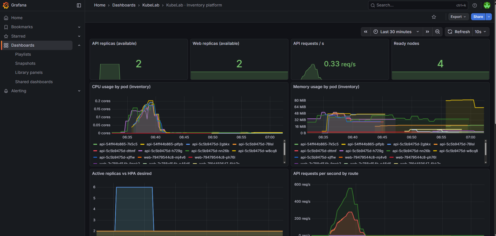
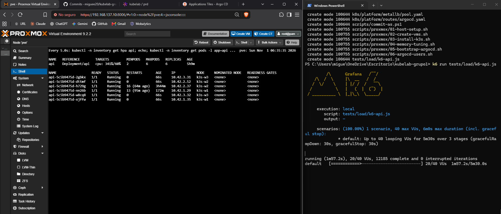
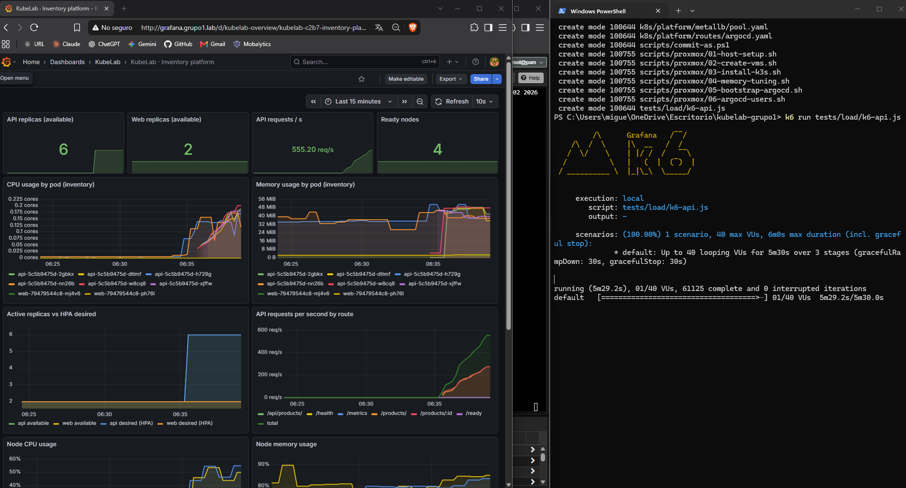
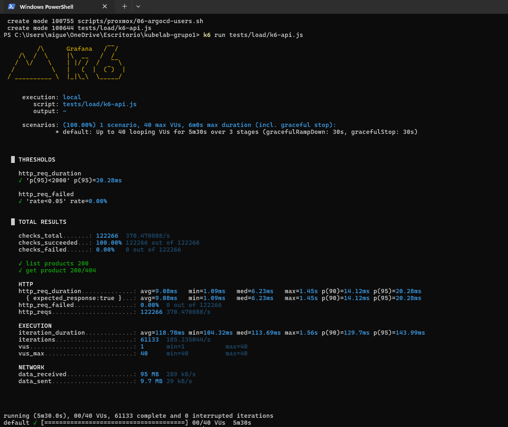
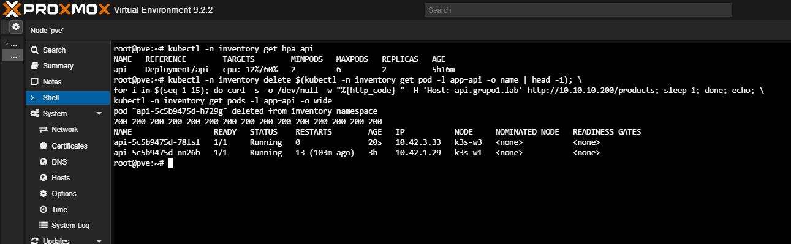

# 05 · Observability, autoscaling and load test

## Stack

| Component | Argo CD Application | Purpose | Storage |
|---|---|---|---|
| Prometheus server | `prometheus` | Scrapes nodes, Kubernetes and the API (OBS-01). Retention 2 days, 30 s scrape interval | 2 Gi PVC on `nfs` |
| node-exporter | `prometheus` (subchart) | Node CPU, memory and disk, DaemonSet on all 4 nodes | — |
| kube-state-metrics | `prometheus` (subchart) | Deployments, replicas, HPA and node status | — |
| Loki | `loki` | Log storage, single binary with filesystem backend, retention 48 h (OBS-02) | 2 Gi PVC on `nfs` |
| Promtail | `promtail` | DaemonSet that ships container logs from every node, control plane included (OBS-02) | — |
| Grafana | `grafana` | Datasources and dashboard provisioned from code (OBS-03, OBS-04) | 1 Gi PVC on `nfs` |

### What Prometheus scrapes

Scrape interval is 60 s. The 10 default jobs of chart 29.x (`scrapeConfigs` map) are disabled. The `kubelab-*` jobs keep only what OBS-01 and the dashboard use, so the TSDB stays small on a 6 GB / HDD host:

| Job | Source | Kept series |
|---|---|---|
| `kubelab-cadvisor` | kubelet cAdvisor on every node | `container_cpu_usage_seconds_total`, `container_memory_working_set_bytes` (per pod) |
| `kubelab-service-endpoints` | Annotated Services: node-exporter (all 4 nodes) and kube-state-metrics | Node metrics and Kubernetes object state (Go runtime and histogram buckets dropped) |
| `kubelab-pods` | Pods with `prometheus.io/scrape: "true"`: the API `/metrics` | `http_requests_total`, request duration sum/count, Node.js heap, process CPU and memory |
| `kubelab-prometheus` | Prometheus itself | All |

`kubelab-service-endpoints` uses `honor_labels: true`. kube-state-metrics reports the namespace of each object (`namespace="inventory"`), and that label must not be replaced by the namespace of the kube-state-metrics Service itself (`monitoring`).

API-server and kubelet histograms are not collected; they were the largest source of series and nothing uses them.

The Prometheus server has a startup probe that allows 10 minutes, because replaying the WAL from an HDD is slow. kube-state-metrics and metrics-server have lenient probes for the same reason.

Targets can be checked at http://prometheus.grupo1.lab/targets.

## Grafana configuration from code

Nothing is configured by hand in the Grafana UI:
- **Datasources:** `Prometheus` (uid `prometheus`, default) and `Loki` (uid `loki`), defined in the Helm values of [`k8s/argocd/apps/grafana.yaml`](../k8s/argocd/apps/grafana.yaml).
- **Dashboard:** [`k8s/observability/dashboards/kubelab.json`](../k8s/observability/dashboards/kubelab.json), loaded through a ConfigMap generated by Kustomize. It is read-only in the UI (`editable: false`).
- **Admin credentials:** `GRAFANA_ADMIN_USER` and `GRAFANA_ADMIN_PASSWORD`, which Doppler syncs into `monitoring/grafana-secrets`.
- **Instructor user:** `docente`, with the Viewer role and password `GRAFANA_VIEWER_PASSWORD` from Doppler. It is created by a PostSync Job ([`grafana-viewer.yaml`](../k8s/observability/grafana-viewer.yaml)).

The Job sets the Viewer role and View permission on the provisioned `KubeLab` folder through the Grafana API. Argo CD runs PostSync hooks only when it syncs, so after changing the Job a sync is triggered once:

```bash
kubectl -n argocd patch application observability-config --type merge \
  -p '{"operation":{"initiatedBy":{"username":"admin"},"sync":{"revision":"main"}}}'
```



### Dashboard "KubeLab · Inventory platform" (OBS-04)

| Panel | Query (summary) |
|---|---|
| API / Web replicas available | `kube_deployment_status_replicas_available` |
| API requests per second | `rate(http_requests_total{app="api"}[3m])` |
| Ready nodes | `kube_node_status_condition{condition="Ready"}` |
| CPU usage by pod | `rate(container_cpu_usage_seconds_total{namespace="inventory"}[3m])` |
| Memory usage by pod | `container_memory_working_set_bytes{namespace="inventory"}` |
| Active replicas vs HPA desired | kube-state-metrics deployment and HPA series |
| API requests per second by route | `http_requests_total` by `route` |
| Node CPU and memory usage | node-exporter |
| Application logs | Loki `{namespace="inventory"}` |

Every `rate()` uses a 3-minute window. With a 60 s scrape interval, a 1-minute window holds a single sample and `rate()` returns nothing.

## Autoscaling and high availability

| Requirement | Implementation |
|---|---|
| HA-01 | `api` and `web` start with 2 replicas, spread across workers with `topologySpreadConstraints` |
| HA-02 | requests/limits, `readinessProbe` and `livenessProbe` on every Deployment |
| HA-03 | `PodDisruptionBudget` with `minAvailable: 1` for `api` and `web` |
| HA-04 | `HorizontalPodAutoscaler` 2–6 replicas at 60 % CPU, fed by metrics-server |

Argo CD ignores `spec.replicas` of both Deployments (`ignoreDifferences` + `RespectIgnoreDifferences`). Without that, `selfHeal` would undo every scaling decision of the HPA.

## Workload placement

The scheduler places pods by their memory *requests*, not their real usage. At first it stacked Grafana, Prometheus, kube-state-metrics and metrics-server on the same worker. That node then stalled on I/O, and its probes started failing. The heavy, stateful pods now carry a **preferred** node affinity, so each worker gets one group. Because the affinity is only preferred, a pod still moves to another worker if its node goes down.

| Worker | Heavy pods |
|---|---|
| k3s-w1 | prometheus-server, kube-state-metrics |
| k3s-w2 | Argo CD application-controller and repo-server, PostgreSQL |
| k3s-w3 | Loki, Grafana |

Grafana and Prometheus use the `Recreate` strategy: their SQLite and TSDB files on the RWO volume must never be opened by two pods at once.

## Load test (HA-05)

The script is [`tests/load/k6-api.js`](../tests/load/k6-api.js): 30 s of warm-up, then 4 minutes at 40 virtual users, then 1 minute of ramp-down.

From a laptop connected to Tailscale with `docs/hosts.txt` applied:

```bash
winget install k6 --source winget       # Windows (once)
k6 run tests/load/k6-api.js
```

In the `pve` shell, at the same time:

```bash
kubectl -n inventory get hpa api -w
kubectl -n inventory get pods -l app=api -w
```

Expected result:
- The HPA target goes above 60 % and the API scales from 2 up to 6 replicas.
- When the test stops, it scales back to 2 after the stabilization window.
- The dashboard shows the replicas and requests per second climbing at the same moment.

### Result (1 Nov 2026)

| Metric | Value |
|---|---|
| HPA CPU target at peak | 341 % of requests (target 60 %) |
| API replicas | 2 → 6 (maximum), spread over k3s-w1, w2 and w3 |
| Requests served | 122 266 in 5 m 30 s (about 370 req/s average, 555 req/s peak) |
| Failed requests | 0.00 % (threshold < 5 %) |
| Latency p95 | 20.28 ms (threshold < 2 s) |

No request failed while the new pods were added, because the readiness probe keeps a pod out of the Service until it can reach the database.







## Pod deletion test (rubric: continuous service)

```bash
kubectl -n inventory delete $(kubectl -n inventory get pod -l app=api -o name | head -1)
kubectl -n inventory get pods -l app=api -w
```



Deleting one API or web pod leaves the other replica serving traffic, and the Deployment recreates the deleted pod. Deleting `postgres-0` or the Grafana, Loki or Prometheus pods recreates them with the same PVC, so no data is lost (PER-02).
