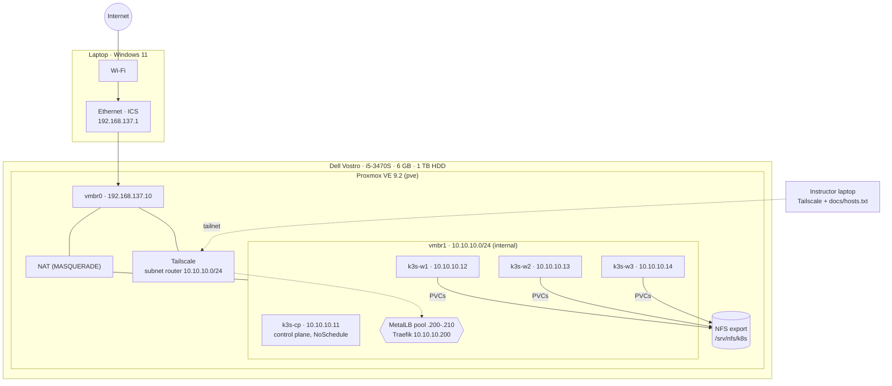
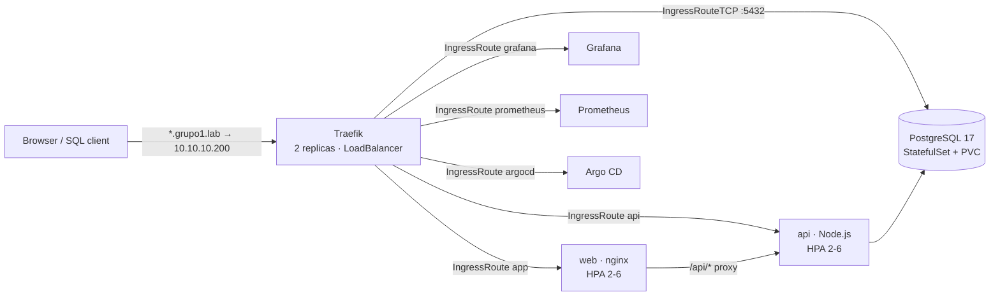
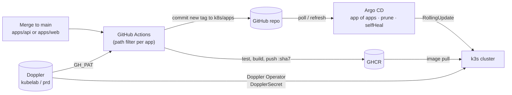
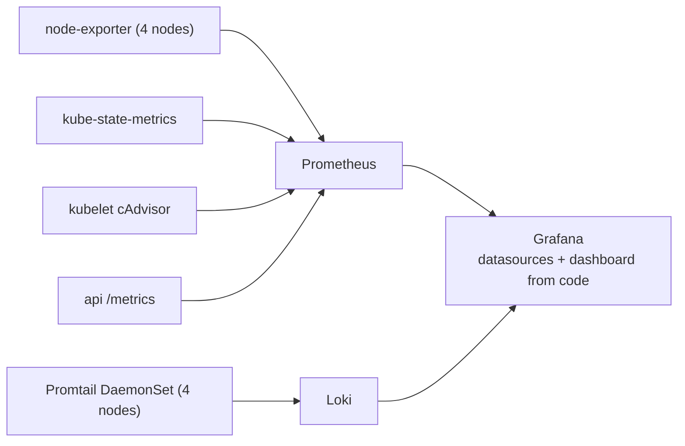

# Architecture

## Physical and virtual layout

The cluster network (`vmbr1`) never changes. Only the laptop's Wi-Fi does, so the cluster works the same at home, at the university and on a phone hotspot.

## Request path

## Delivery path (GitOps)

## Observability path

